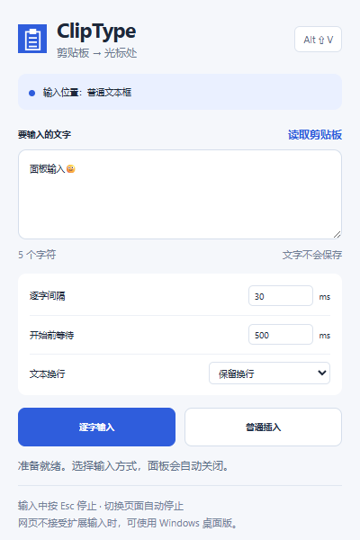

# ClipType

把剪贴板文字输入到光标处。提供 **Windows 桌面版**和 **Chrome / Edge 扩展版**，支持逐字输入和一次插入。

[下载最新版](https://github.com/Wisper-beep/cliptype/releases/latest) · [扩展安装说明](extension/README.md) · [桌面版说明](docs/windows.md) · [隐私说明](extension/PRIVACY.md)



## 选择版本

| | 浏览器扩展 | Windows 桌面版 |
| --- | --- | --- |
| 使用位置 | Chrome / Edge 的普通网页 | 网页、聊天软件、编辑器等桌面程序 |
| 快捷键 | Alt + Shift + V | Ctrl + Alt + V |
| 输入方式 | 逐字输入 / 普通插入 | 模拟键盘输入 / Ctrl + V 粘贴 |
| 支持目标 | input、textarea、常见 contenteditable | 接受 Windows Unicode 模拟按键的输入框 |
| 停止 | Esc、页面停止按钮、焦点或光标改变 | Esc、窗口或原生控件焦点改变 |

## 安装浏览器扩展

1. 从 [Releases](https://github.com/Wisper-beep/cliptype/releases/latest) 下载 `ClipType-Extension.zip`，解压到固定目录。
2. Chrome 打开 `chrome://extensions`；Edge 打开 `edge://extensions`，开启「开发者模式」。
3. 点击「加载已解压的扩展程序」，选择包含 `manifest.json` 的目录。
4. 把 ClipType 固定到工具栏。复制文字，点击目标网页输入框，再点击扩展图标或按 **Alt + Shift + V**。
5. 检查文字和输入位置，选择「逐字输入」或「普通插入」。输入过程中按 **Esc** 可停止。

这是 GitHub 分发的解压版，尚未上架扩展商店。移动或删除安装目录会影响扩展加载。快捷键冲突可在浏览器的扩展快捷键设置页修改。

## 使用桌面版

下载 `ClipType-Windows.zip`，解压并运行 `ClipType.exe`。复制文字，在目标输入框放好光标，按 **Ctrl + Alt + V**，选择「模拟输入」或「普通粘贴」。支持调速、延迟开始和托盘常驻。

桌面版面向 Windows 10 / 11，依赖系统自带的 .NET Framework 4.5 或更新版本，不需要安装额外组件。

## 功能与限制

- 中文、英文、表情和组合字符；逐字间隔 0–500 ms；单次最多 100,000 个 UTF-16 字符。
- 在原光标处插入或替换原选区。Tab 转为 4 个空格；单行输入框自动把换行改为空格。
- 扩展的逐字输入触发文字编辑和 input 事件，不派发 Enter 键，也不主动提交表单。行为仍取决于网页自身逻辑。
- 扩展支持同源 iframe 和开放的 Shadow DOM。跨域 iframe、浏览器设置页、扩展商店、Google Docs 等特殊编辑器不在支持范围。
- 扩展无法产生真实硬件按键，也无法保证网站接收合成事件；`KeyboardEvent.isTrusted` 为 false。对真实性有要求的输入框可尝试桌面版；桌面版也不保证支持所有程序。
- 不联网、不采集数据、不保存剪贴板历史。扩展仅在调用时临时访问当前网页；本地只保存速度、延迟和换行设置。

## 开发与检查

```sh
npm ci
npm test
npx playwright install chromium
npm run test:browser
```

浏览器测试启动独立的临时 Chromium 配置，只访问本地测试页；不操作个人浏览器。为替代人工工具栏授权，临时测试副本会增加 localhost 权限，发行版没有网站常驻权限。弹窗测试替换剪贴板读取和活动标签查询；其余消息传递、脚本注入与 DOM 输入使用实际扩展 API。

Windows 构建和打包：

```powershell
.\build.ps1 -Test
.\scripts\package.ps1
```

输出在 `dist`，包含桌面版和扩展版两个 ZIP。GitHub Actions 自动运行扩展基础测试、Chromium 集成测试和桌面版构建检查。

```text
extension/    Chrome / Edge Manifest V3 扩展
src/          Windows 桌面版 C# 源码
tests/        扩展和桌面版测试、本地网页测试页
scripts/      图标生成、打包和发布脚本
docs/         桌面版说明与验证记录
```

MIT License。
